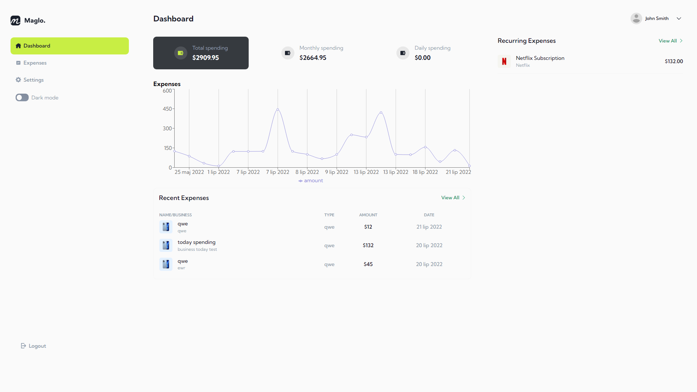
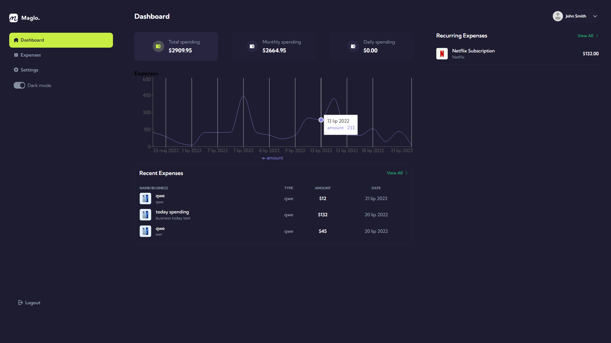
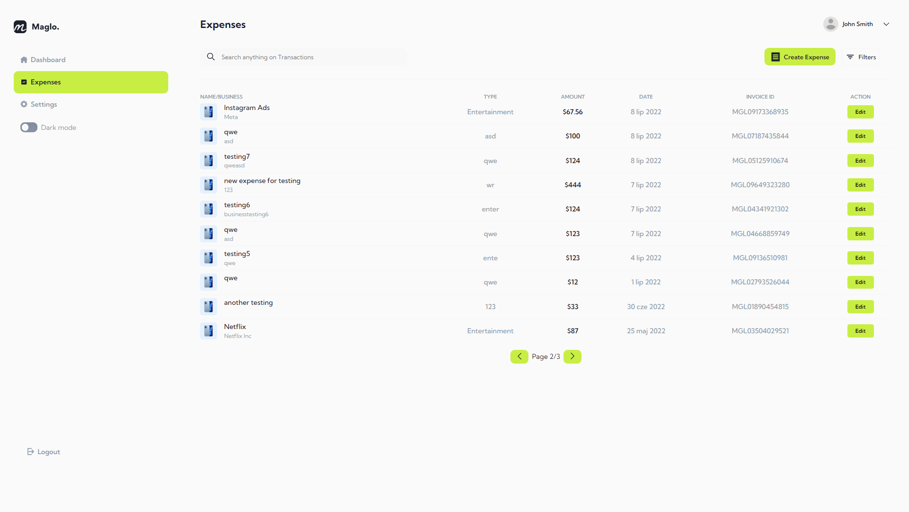

# React Minimal Financial Management App

Minimal financial management dashboard built with React, Firebase, and Vite.

## Tech Stack

- React 18
- Vite
- TypeScript
- Firebase Auth
- Firestore
- React Router
- Recharts
- Vitest

## Scripts

```bash
npm run dev
npm run build
npm run test:run
npm run preview
```

## Environment

Create a local `.env` file with these Vite variables:

```bash
VITE_FIREBASE_API_KEY=
VITE_FIREBASE_AUTH_DOMAIN=
VITE_FIREBASE_PROJECT_ID=
VITE_FIREBASE_STORAGE_BUCKET=
VITE_FIREBASE_MESSAGING_SENDER_ID=
VITE_FIREBASE_APP_ID=
VITE_FIREBASE_MEASUREMENT_ID=
```

The previous Create React App `REACT_APP_*` variables are no longer read.

## Screenshots





